 

My projects start with something that bugs me. 
So I build my way out of it.

**Usually in:** Python, C++, Swift, JavaScript, Java · ESP32 + Arduino

&nbsp;&nbsp;

[View my résumé](./Jetha_Rehan_Resume_Website.pdf)

